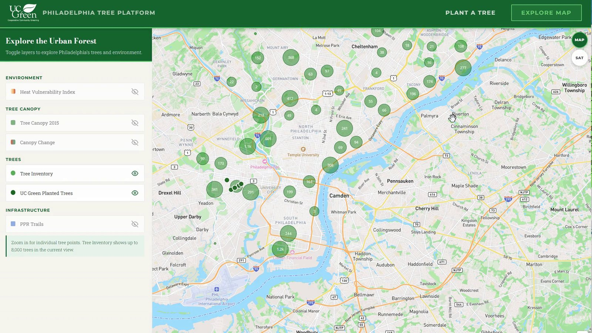
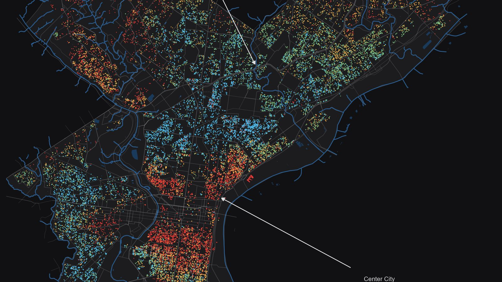

```{=html}
<div class="hp">
<div class="hp-wrap">

  <!-- ══ Header ══ -->
  <header class="hp-header">
    <a class="hp-mark" href="index.html"><span class="hp-dot"></span><span>Portfolio</span></a>
    <nav class="hp-nav" aria-label="Homepage sections">
      <a href="#work">Selected work</a>
      <a href="#more">More projects</a>
      <a href="#contact">Contact</a>
      <a class="hp-nav-cta" href="assets/Isabelle-Li-resume.pdf" target="_blank" rel="noopener">Résumé</a>
    </nav>
  </header>

  <!-- ══ Hero: name + intro | education ══ -->
  <section class="hp-hero">
    <div class="hp-hero-main">
      <div>
        <h1 class="hp-name">Isabelle Li</h1>
        <p class="hp-role">Quantitative analyst &amp; researcher</p>
      </div>
      <div class="hp-intro">
        <p>I'm Isabelle, a quantitative analyst and researcher with a background in mathematics, economics, and spatial analytics. I'm drawn to interesting questions, complicated problems, and the stories hidden in data. My work spans statistical modeling, geospatial analysis, and applied research, with an emphasis on making complex findings clear, interpretable, and useful.</p>
        <p class="hp-intro-close">This is a collection of things I've explored, built, and written along the way.</p>
      </div>
      <div class="hp-actions">
        <a class="hp-btn" href="assets/Isabelle-Li-resume.pdf" download><i class="bi bi-download" aria-hidden="true"></i><span>Download résumé (PDF)</span></a>
        <a class="hp-icon" href="https://www.linkedin.com/in/isabellelii" target="_blank" rel="noopener" aria-label="LinkedIn" title="LinkedIn"><i class="bi bi-linkedin" aria-hidden="true"></i></a>
        <a class="hp-icon" href="https://github.com/Isabelliiii" target="_blank" rel="noopener" aria-label="GitHub" title="GitHub"><i class="bi bi-github" aria-hidden="true"></i></a>
        <a class="hp-icon" href="mailto:isabelliii2023@gmail.com" aria-label="Email" title="Email"><i class="bi bi-envelope" aria-hidden="true"></i></a>
      </div>
    </div>

    <div class="hp-edu">
      <p class="hp-label">Education</p>
      <dl>
        <div>
          <dt>Master of Urban Spatial Analytics</dt>
          <dd>University of Pennsylvania, Weitzman School of Design</dd>
          <dd class="hp-meta">2026</dd>
        </div>
        <div>
          <dt>Honours BSc, Mathematics &amp; Economics</dt>
          <dd>University of Toronto</dd>
          <dd class="hp-meta">2025</dd>
        </div>
        <div>
          <dt class="hp-meta">Works in</dt>
          <dd class="hp-tools">Python, SQL, R, Tableau, BigQuery, GIS</dd>
        </div>
      </dl>
    </div>
  </section>

  <!-- ══ Selected work ══ -->
  <section class="hp-work" id="work">
    <h2 class="hp-h2">Selected work</h2>
    <div class="hp-features">

      <article class="hp-feature">
        <a class="hp-shot" href="dashboard/tree-planting.html" aria-label="Tree Planting Decision System">
          
        </a>
        <div class="hp-feature-text">
          <p class="hp-label">Decision tool</p>
          <h3 class="hp-h3">Tree Planting Decision System</h3>
          <p>A planning and request interface for Philadelphia's street trees. Planners explore heat exposure, canopy change and the existing tree inventory on one map, and residents can submit a planting request for a specific site.</p>
        </div>
        <div class="hp-feature-foot">
          <span>Python · SQL · Tableau · JavaScript</span>
          <a href="dashboard/tree-planting.html">Open the tool →</a>
        </div>
      </article>

      <article class="hp-feature">
        <a class="hp-shot" href="dashboard/housing-cama.html" aria-label="Philadelphia CAMA Assessment Review">
          
        </a>
        <div class="hp-feature-text">
          <p class="hp-label">Dashboard + model</p>
          <h3 class="hp-h3">Philadelphia CAMA Assessment Review</h3>
          <p>A property valuation model for Philadelphia, with two review portals: one for assessors comparing predicted and official values across the city, one for owners looking up their own parcel.</p>
          <p class="hp-result">Covers about 80,000 residential properties, with R² above 0.70.</p>
        </div>
        <div class="hp-feature-foot">
          <span>Python · scikit-learn · SQL · BigQuery</span>
          <a href="dashboard/housing-cama.html">Open the dashboard →</a>
        </div>
      </article>

    </div>
  </section>

  <!-- ══ More projects ══ -->
  <section class="hp-more" id="more">
    <h2 class="hp-h2">More projects</h2>
    <div class="hp-groups">

      <div class="hp-group">
        <h3 class="hp-group-name">Modelling</h3>
        <div class="hp-group-items">
          <a class="hp-item" href="Projects/Fire%20Alarm%20Prediction/fire-alarm-preview.html">
            <span class="hp-item-text">
              <span class="hp-item-title">Fire Alarm Prediction</span>
              <span class="hp-item-desc">Which Philadelphia fire alarms are likely to be false, predicted from spatial and socioeconomic data.</span>
            </span>
            <span class="hp-item-arrow" aria-hidden="true">→</span>
          </a>
          <a class="hp-item" href="Projects/Philadelphia%20Housing%20Model/housing-preview.html">
            <span class="hp-item-text">
              <span class="hp-item-title">Philadelphia Housing Model</span>
              <span class="hp-item-desc">What census and assessment data explain about home values, block by block.</span>
            </span>
            <span class="hp-item-arrow" aria-hidden="true">→</span>
          </a>
        </div>
      </div>

      <div class="hp-group">
        <h3 class="hp-group-name">Research &amp; visualization</h3>
        <div class="hp-group-items">
          <a class="hp-item" href="https://uxiaoo22.github.io/python/part1.html" target="_blank" rel="noopener">
            <span class="hp-item-text">
              <span class="hp-item-title">Elephant Habitat Suitability</span>
              <span class="hp-item-desc">Where elephants can still live across Southeast Asia, mapped from remote sensing and GIS data.</span>
            </span>
            <span class="hp-item-arrow" aria-hidden="true">→</span>
          </a>
          <a class="hp-item" href="visualization.html">
            <span class="hp-item-text">
              <span class="hp-item-title">Maps and charts</span>
              <span class="hp-item-desc">One-off visualizations from urban and spatial datasets.</span>
            </span>
            <span class="hp-item-arrow" aria-hidden="true">→</span>
          </a>
        </div>
      </div>

      <div class="hp-group">
        <h3 class="hp-group-name">Community &amp; writing</h3>
        <div class="hp-group-items">
          <a class="hp-item" href="Community%20Engagement/EPCDB/EPCDB.html">
            <span class="hp-item-text">
              <span class="hp-item-title">East Parkside Applied Case</span>
              <span class="hp-item-desc">Outreach and planning support for the East Parkside Community Development Board.</span>
            </span>
            <span class="hp-item-arrow" aria-hidden="true">→</span>
          </a>
          <a class="hp-item" href="Community%20Engagement/Published%20Writing-NAMUN.html">
            <span class="hp-item-text">
              <span class="hp-item-title">NAMUN 2024 articles</span>
              <span class="hp-item-desc">On the ethics of reporting an international crisis, and notes from the conference.</span>
            </span>
            <span class="hp-item-arrow" aria-hidden="true">→</span>
          </a>
        </div>
      </div>

    </div>
  </section>

  <!-- ══ Footer / contact ══ -->
  <footer class="hp-footer" id="contact">
    <div class="hp-footer-main">
      <h2 class="hp-footer-title">Get in touch</h2>
      <p class="hp-email"><a href="mailto:isabelliii2023@gmail.com">isabelliii2023@gmail.com</a></p>
    </div>
    <nav class="hp-footer-nav" aria-label="Elsewhere">
      <a href="https://www.linkedin.com/in/isabellelii" target="_blank" rel="noopener">LinkedIn</a>
      <a href="https://github.com/Isabelliiii" target="_blank" rel="noopener">GitHub</a>
      <a href="assets/Isabelle-Li-resume.pdf" target="_blank" rel="noopener">Résumé (PDF)</a>
    </nav>
  </footer>

</div>
</div>
```
